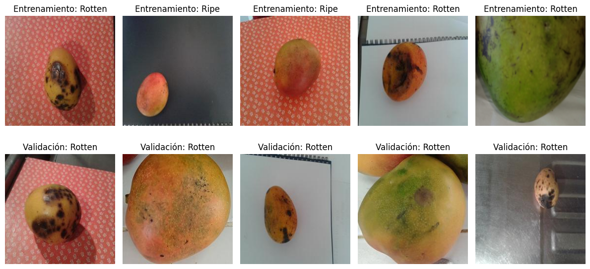

# AI-Powered Mango Classifier

This repository contains a machine learning project for classifying mangoes as "Ripe" or "Rotten" based on image analysis. Using a supervised learning approach, various models are trained and evaluated on a dataset of mango images to distinguish between the two classes based on visual features.



## Table of Contents
- [Overview](#overview)
- [Project Structure](#project-structure)
- [Data Pipeline](#data-pipeline)
  - [1. Data Loading](#1-data-loading)
  - [2. Preprocessing](#2-preprocessing)
  - [3. Feature Extraction](#3-feature-extraction)
  - [4. Dimensionality Reduction](#4-dimensionality-reduction)
- [Models](#models)
- [Results](#results)
- [Setup and Usage](#setup-and-usage)
  - [Prerequisites](#prerequisites)
  - [Installation](#installation)
  - [Running the Analysis](#running-the-analysis)

## Overview
The goal of this project is to build a classifier that can accurately determine whether a mango is ripe or rotten from an image. The project utilizes a dataset from [Kaggle](https://www.kaggle.com/datasets/adrinbd/unripe-ripe-rotten-mango), focusing on the 2,100 images labeled as `Ripe` and `Rotten`.

The analysis involves several stages:
1.  **Data Preprocessing**: Images are processed to extract meaningful features.
2.  **Feature Extraction**: Statistical, color, and texture features are extracted from each image.
3.  **Model Training**: Multiple classification models are trained on the extracted features.
4.  **Evaluation**: Models are evaluated using various metrics to compare their performance.

## Project Structure
The repository is organized as follows:
```
└── mangifera/
    ├── requirements.txt         # Project dependencies
    ├── notebooks/
    │   └── mangifera.ipynb      # Main Jupyter notebook with analysis and visualizations
    └── src/
        ├── data/                # Modules for data loading, processing, and visualization
        │   ├── features.py      # Feature extraction and scaling
        │   ├── graphic.py       # Visualization functions
        │   ├── processed.py     # Preprocessing pipeline orchestrator
        │   └── raw.py           # Raw data loading from Kaggle
        └── model/               # Modules for different classification models
            ├── classification.py# Base classification model class
            ├── dnn.py           # Deep Neural Network (Keras)
            ├── forest.py        # Random Forest Classifier
            ├── neural.py        # MLP Neural Network
            ├── regression.py    # Ridge Regression
            └── tree.py          # Decision Tree Classifier
```

## Data Pipeline

### 1. Data Loading
- The dataset is automatically downloaded from Kaggle using `kagglehub`.
- Image paths and labels are organized into CSV files for training and validation sets, separating `Ripe` and `Rotten` classes.

### 2. Preprocessing
- **Label Encoding**: The categorical labels 'Ripe' and 'Rotten' are encoded into binary values (0 and 1) using `LabelEncoder`.
- **Feature Scaling**: All extracted features are scaled to a [0, 1] range using `MinMaxScaler` to ensure consistent scale across all features.
- **Data Balancing**: To address the imbalanced nature of the dataset (more `Rotten` images than `Ripe`), class weights are calculated and applied during model training.

### 3. Feature Extraction
A comprehensive set of features is extracted from each image to capture its visual characteristics:
- **RGB Statistics**: Mean and standard deviation for each of the R, G, and B color channels.
- **RGB Histograms**: 256-bin histograms for each color channel, concatenated into a single feature vector.
- **Haralick Texture Features**: Calculated from the Gray-Level Co-occurrence Matrix (GLCM), these include:
  - Contrast
  - Correlation
  - Energy
  - Homogeneity

### 4. Dimensionality Reduction
- **Principal Component Analysis (PCA)** is applied to reduce the dimensionality of the feature set while retaining 95% of the variance.
- The models are trained and evaluated on both the full feature set and the PCA-reduced feature set to compare performance.

## Models
Several classification models were trained and evaluated to find the best-performing one for this task. Hyperparameter tuning was performed using `GridSearchCV`.

1.  **Ridge Regression (`Ridge`)**: A regularized linear model used as a baseline.
2.  **Decision Tree (`DecisionTreeClassifier`)**: A non-linear model that splits data based on feature values.
3.  **Random Forest (`RandomForestClassifier`)**: An ensemble of decision trees to improve robustness and reduce overfitting.
4.  **MLP Classifier (`MLPClassifier`)**: A multi-layer perceptron (feed-forward neural network) from scikit-learn.
5.  **Deep Neural Network (DNN)**: A sequential model built with Keras/TensorFlow, featuring multiple dense layers, `BatchNormalization`, and `Dropout` for regularization.

## Results
- The models trained on the **full extracted feature set** significantly outperformed those trained on PCA-reduced data. This suggests that the feature reduction process, while efficient, removed information crucial for classification.
- The **Deep Neural Network (DNN)** and **MLP Classifier** achieved the highest validation accuracies, reaching up to 99% and 98%, respectively.
- The **Random Forest** model also performed exceptionally well, with a validation accuracy of 97%.
- Analysis of the confusion matrices showed that while models were highly accurate in identifying rotten mangoes, they occasionally struggled with ripe ones, indicating the class imbalance still had a minor effect on predictions.
- Simpler models like Ridge Regression and Decision Trees were less effective, highlighting the complexity of the classification task.

## Setup and Usage

### Prerequisites
- Python 3.8+
- An environment with the packages listed in `requirements.txt`.

### Installation
1.  Clone the repository:
    ```bash
    git clone https://github.com/dejesusbg/mangifera.git
    cd mangifera
    ```

2.  Install the required dependencies:
    ```bash
    pip install -r requirements.txt
    ```

3.  Set up Kaggle API credentials to allow the script to download the dataset. Follow the instructions [here](https://www.kaggle.com/docs/api).

### Running the Analysis
The entire analysis, from data download to model evaluation, can be reproduced by running the `notebooks/mangifera.ipynb` notebook in a Jupyter environment. The notebook is structured to be executed cell-by-cell and includes detailed explanations and visualizations for each step.
